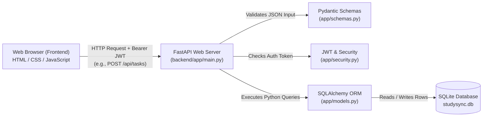
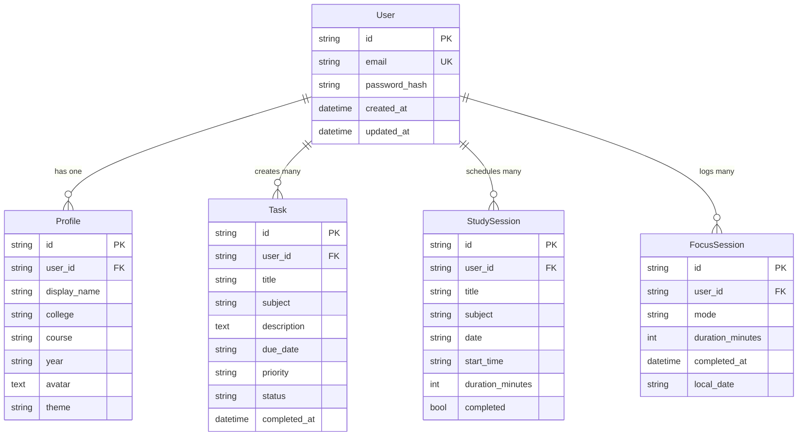

# StudySync Backend Learning & Viva Guide 🎓

Welcome to the backend documentation for **StudySync**! This guide is written specifically for beginners. It explains every piece of the backend in plain English, with real code examples and simple analogies. By reading this guide, you will be able to confidently explain your project architecture, security, and database design in any college viva or interview.

---

## Table of Contents
1. [Big Picture: What is a Backend & Why StudySync Needs It](#1-big-picture)
2. [Tech Stack in Plain Words](#2-tech-stack-in-plain-words)
3. [File-by-File Explanation](#3-file-by-file-explanation)
4. [Step-by-Step Request Walkthrough: Adding a Task](#4-step-by-step-request-walkthrough)
5. [Authentication & Security Explained Simply](#5-authentication--security-explained-simply)
6. [Database Tables & Relationships](#6-database-tables--relationships)
7. [Complete API Endpoint Table](#7-complete-api-endpoint-table)
8. [How to Explore & Debug the App Yourself](#8-how-to-explore--debug-the-app-yourself)
9. [Five Practice Tasks (With File Hints)](#9-five-practice-tasks)
10. [Glossary of Technical Terms](#10-glossary-of-technical-terms)
11. [College Viva Preparation: 25 Questions & Answers](#11-college-viva-preparation-25-qa)
12. [5-Minute Live Project Demo Script](#12-5-minute-live-project-demo-script)

---

## 1. Big Picture

### What is a Backend?
Think of a restaurant:
- **Frontend (Customer):** The person sitting at the table viewing the menu and pressing buttons (ordering food).
- **Backend API (Waiter):** Takes the order from the table, checks if it's allowed, and delivers it to the kitchen.
- **Database (Kitchen Pantry / Safe):** Stores the ingredients and recipes permanently. Even if the customer leaves the table, the pantry keeps everything safe.

### Why StudySync Needs a Backend
Originally, StudySync stored tasks in the browser's `localStorage`. This had 3 big problems:
1. **No Real Accounts:** Anyone opening the computer saw the same data.
2. **Device Isolation:** Tasks created on a laptop did not show up on a phone or another browser.
3. **Accidental Deletion:** Clearing browser history or cookies wiped out all study records.

With our FastAPI backend and SQLite database:
- Each student registers their own account with an email and password.
- All data is securely locked to their unique `user_id`.
- The database file (`studysync.db`) keeps tasks, study schedules, and timer sessions safe permanently.

### Architecture Diagram



---

## 2. Tech Stack in Plain Words

| Technology | What it is | Why we chose it for StudySync |
| :--- | :--- | :--- |
| **Python 3.11+** | Modern programming language | Clean syntax, beginner-friendly, and standard in academic settings. |
| **FastAPI** | Fast Python web framework | Automatically validates request data, builds interactive documentation at `/docs`, and runs very quickly. |
| **Uvicorn** | High-performance ASGI web server | The engine that runs FastAPI and listens for HTTP requests on `http://127.0.0.1:8000`. |
| **SQLAlchemy 2.x** | Object-Relational Mapper (ORM) | Lets us write Python classes (`Task`, `User`) instead of writing raw SQL strings (`SELECT * FROM tasks`). Prevents SQL injection attacks. |
| **Pydantic v2** | Data validation library | Acts as an automatic security guard. Ensures title has at most 120 letters, passwords are at least 8 characters, and dates match `YYYY-MM-DD`. |
| **SQLite (`studysync.db`)** | Lightweight, file-based database | Requires zero installation or external servers. Runs everywhere on Windows, Mac, and Linux out of the box. |
| **JWT (`PyJWT`)** | JSON Web Tokens | Digital ID card given to the user upon login. The browser includes it in every request so the server knows who is asking. |
| **`bcrypt`** | Cryptographic password hasher | Converts plain passwords (like `secret123`) into irreversible random hashes before saving them to disk. |

---

## 3. File-by-File Explanation

All backend code lives inside `studysync/backend/app/`. Here is what each file does and who it talks to:

### `app/main.py`
- **What it does:** The main entry point of the entire application. It sets up FastAPI, enables CORS (so Live Server can talk to it), registers all router endpoints, seeds the demo user (`demo@studysync.app`), and serves the frontend HTML/JS/CSS files at `/`.
- **Talks to:** `config.py`, `database.py`, `models.py`, and all router files in `app/routers/`.

### `app/config.py`
- **What it does:** Reads settings from environment variables or the `.env` file (such as `SECRET_KEY`, `DATABASE_URL`, and `TOKEN_EXPIRE_MINUTES`). Also automatically normalizes PostgreSQL URLs for cloud deployment.
- **Talks to:** Reads from `../.env` and feeds settings into `database.py`, `security.py`, and `main.py`.

### `app/database.py`
- **What it does:** Creates the SQLAlchemy database engine, session factory (`SessionLocal`), and declarative base (`Base`). Provides the `get_db` dependency to give routers clean database sessions that auto-close after every request.
- **Talks to:** `config.py` (for `DATABASE_URL`), used by `models.py` and routers.

### `app/models.py`
- **What it does:** Defines our database tables as Python classes (`User`, `Profile`, `Task`, `StudySession`, `FocusSession`). Sets up primary keys, indexes, foreign keys, and `cascade="all, delete-orphan"`.
- **Talks to:** `database.py` (inherits from `Base`), referenced by all routers.

### `app/schemas.py`
- **What it does:** Defines the shapes of incoming JSON requests and outgoing JSON responses using Pydantic models. Validates text lengths, email formats, enum options (`high`, `medium`, `low`), and date patterns.
- **Talks to:** Routers use these schemas to parse request bodies and format output data.

### `app/security.py`
- **What it does:** Contains helper functions for security: hashes and checks passwords using `bcrypt`, creates and decodes JWT tokens using `PyJWT`, and tracks failed login attempts to prevent brute-force attacks.
- **Talks to:** `config.py` (for secret key and token expiry time), used by `deps.py` and `routers/auth.py`.

### `app/deps.py`
- **What it does:** Contains the `get_current_user` dependency. It extracts the HTTP Bearer token from the incoming request header, decodes the user ID, looks up the user in the database, and blocks unauthorized requests with a `401 Unauthorized` status.
- **Talks to:** `database.py`, `models.py`, `security.py`, and protects endpoints in all domain routers.

### `app/routers/auth.py`
- **What it does:** Handles user onboarding: `POST /api/auth/register`, `POST /api/auth/login`, and `GET /api/auth/me`. Checks password hashes and issues JWT tokens.
- **Talks to:** `models.py`, `schemas.py`, `security.py`, `deps.py`.

### `app/routers/tasks.py`
- **What it does:** Full CRUD for student tasks (`GET`, `POST`, `PUT`, `DELETE`). Includes `PATCH /api/tasks/{id}/toggle` to switch between pending and completed, plus search, filter, and sort.
- **Talks to:** `models.Task`, `schemas.py`, `deps.py`.

### `app/routers/planner.py`
- **What it does:** Manages study sessions on the calendar (`GET`, `POST`, `PUT`, `DELETE`, and `PATCH /api/sessions/{id}/toggle-complete`). Supports `?from=&to=` date filtering.
- **Talks to:** `models.StudySession`, `schemas.py`, `deps.py`.

### `app/routers/focus.py`
- **What it does:** Manages Pomodoro focus history (`GET /api/focus` and `POST /api/focus`). Features **idempotent session recording**: if the client re-sends the same UUID after a network drop, it will not double-count the session.
- **Talks to:** `models.FocusSession`, `schemas.py`, `deps.py`.

### `app/routers/profile.py`
- **What it does:** Reads and updates the user's personal details (`display_name`, `college`, `course`, `year`, `avatar`, `theme`).
- **Talks to:** `models.Profile`, `schemas.py`, `deps.py`.

### `app/routers/data.py`
- **What it does:** Complete data management: `GET /api/export` downloads all user data as JSON; `POST /api/import` imports legacy browser data; `DELETE /api/data` resets all records after confirmation.
- **Talks to:** All database models, `deps.py`.

### `app/routers/analytics.py`
- **What it does:** Computes total tasks, completion rate, overdue tasks, subject distribution, and daily study minutes for the last 7 days based on the client's local date (`?today=YYYY-MM-DD`).
- **Talks to:** `models.Task`, `models.StudySession`, `models.FocusSession`, `deps.py`.

---

## 4. Step-by-Step Request Walkthrough

Let us follow what happens behind the scenes when a student clicks **"Add Task"** in StudySync:

```
[User clicks "Add Task"]
          │
          ▼
1. frontend/js/tasks.js: _saveTask()
          │ Reads form input values from modal
          ▼
2. frontend/js/state.js: addTask(taskData)
          │ Adds task optimistically to UI state
          ▼
3. frontend/js/api.js: api.tasks.create(payload)
          │ Sends HTTP POST to http://127.0.0.1:8000/api/tasks
          │ Attaches header: "Authorization: Bearer <jwt_token>"
          ▼
4. backend/app/deps.py: get_current_user()
          │ Decodes token payload sub -> retrieves current User
          ▼
5. backend/app/schemas.py: TaskCreate
          │ Validates title <= 120 chars, due_date pattern, priority enum
          ▼
6. backend/app/routers/tasks.py: create_task()
          │ Creates Task(user_id=current_user.id, title=..., ...)
          │ Calls db.add(new_task) and db.commit()
          ▼
7. SQLite Database: studysync.db
          │ Executes: INSERT INTO tasks (id, user_id, title, ...) VALUES (...)
          ▼
8. backend/app/schemas.py: TaskResponse
          │ Converts created Task model into JSON response with 201 Created
          ▼
9. frontend/js/api.js -> state.js -> tasks.js
          │ Replaces temporary ID with real backend UUID
          │ Triggers state.emit('tasks:change')
          │ UI calendar, dashboard, and task list re-render immediately!
```

---

## 5. Authentication & Security Explained Simply

### 1. Password Hashing (Never Store Plain Passwords)
- When a student registers with password `"secret123"`, we **never** store `"secret123"` in the database.
- Instead, `security.py` uses `bcrypt.hashpw()` with random salt rounds.
- It transforms the password into a cryptographic hash like:  
  `$2b$12$e8xH.KkO0eP91XjQeWf6Q.x7eZg0Zt6k0gA4x2xL2a5wY7m6Q...`
- Even if someone opens `studysync.db`, they cannot reverse the hash to find the student's password.
- When logging in, `bcrypt.checkpw()` mathematically tests if the entered password matches the hash without ever unhashing it.

### 2. JWT Access Tokens (The VIP Wristband)
- After valid login, the server issues a **JSON Web Token (JWT)** signed with our secret key.
- The token consists of three parts separated by dots: `Header.Payload.Signature`.
  - **Header:** Algorithm used (`HS256`).
  - **Payload:** User ID (`sub`), email, and expiration timestamp (`exp`).
  - **Signature:** Cryptographic verification stamp created using `SECRET_KEY`.
- The browser stores this token in `localStorage.setItem("studysync:v1:token", ...)`.
- For every future API request, `api.js` automatically sends:  
  `Authorization: Bearer <token>`
- If the token is tampered with or expired, `deps.py` immediately rejects the request with HTTP `401 Unauthorized`.

### 3. User Data Isolation (Multi-Tenant Privacy)
How do we ensure Student A cannot see Student B's homework?
- Every query in `tasks.py`, `planner.py`, `focus.py`, `profile.py`, and `data.py` strictly includes:
  ```python
  query = db.query(Task).filter(Task.user_id == current_user.id)
  ```
- If Student B tries to open `/api/tasks/task-id-belonging-to-student-a`, the server filters by `Task.id == id AND Task.user_id == student_b.id`.
- The query returns `None`, and the server sends a clean `404 Not Found`. Student B cannot even know whether that task exists.

### 4. Brute-Force Rate Throttling
- If an attacker repeatedly tries guessing passwords, `security.py` tracks failed attempts per `email + IP`.
- If 5 incorrect passwords are typed within 5 minutes, `routers/auth.py` blocks further attempts with HTTP `429 Too Many Requests`.

---

## 6. Database Tables & Relationships

Our database has 5 tables with UUID string primary keys and foreign keys with `ON DELETE CASCADE`.



### Example Table Rows

#### 1. `users` Table
| Column | Type | Example Value |
| :--- | :--- | :--- |
| `id` (PK) | String(36) | `"b9a7c6f0-1234-4567-89ab-cdef01234567"` |
| `email` | String(255) | `"demo@studysync.app"` |
| `password_hash` | String(255) | `"$2b$12$fT54yQ... (bcrypt hash)"` |
| `created_at` | DateTime | `"2026-10-18 10:00:00"` |
| `updated_at` | DateTime | `"2026-10-18 10:00:00"` |

#### 2. `profiles` Table
| Column | Type | Example Value |
| :--- | :--- | :--- |
| `id` (PK) | String(36) | `"p1b8d234-..."` |
| `user_id` (FK) | String(36) | `"b9a7c6f0-1234-4567-89ab-cdef01234567"` |
| `display_name` | String(100) | `"Alex Chen"` |
| `college` | String(120) | `"Tech Institute"` |
| `course` | String(120) | `"Computer Science"` |
| `year` | String(50) | `"3rd Year"` |
| `theme` | String(20) | `"system"` |

#### 3. `tasks` Table
| Column | Type | Example Value |
| :--- | :--- | :--- |
| `id` (PK) | String(36) | `"t9c4a112-..."` |
| `user_id` (FK) | String(36) | `"b9a7c6f0-1234-4567-89ab-cdef01234567"` |
| `title` | String(120) | `"Complete CS106B Binary Trees Assignment"` |
| `subject` | String(60) | `"Data Structures"` |
| `description` | Text | `"Implement AVL balancing and traversal"` |
| `due_date` | String(10) | `"2026-10-25"` |
| `priority` | String(20) | `"high"` |
| `status` | String(20) | `"pending"` |
| `completed_at` | DateTime | `NULL` |

#### 4. `study_sessions` Table
| Column | Type | Example Value |
| :--- | :--- | :--- |
| `id` (PK) | String(36) | `"s5e9f821-..."` |
| `user_id` (FK) | String(36) | `"b9a7c6f0-1234-4567-89ab-cdef01234567"` |
| `title` | String(120) | `"Tree Traversal Algorithm Practice"` |
| `subject` | String(60) | `"Data Structures"` |
| `date` | String(10) | `"2026-10-18"` |
| `start_time` | String(10) | `"14:00"` |
| `duration_minutes` | Integer | `60` |
| `completed` | Boolean | `False` |

#### 5. `focus_sessions` Table
| Column | Type | Example Value |
| :--- | :--- | :--- |
| `id` (PK) | String(36) | `"client-uuid-987123"` |
| `user_id` (FK) | String(36) | `"b9a7c6f0-1234-4567-89ab-cdef01234567"` |
| `mode` | String(30) | `"focus"` |
| `duration_minutes` | Integer | `25` |
| `completed_at` | DateTime | `"2026-10-18 12:45:00"` |
| `local_date` | String(10) | `"2026-10-18"` |

---

## 7. Complete API Endpoint Table

| Method | Endpoint | Description | Login Required? |
| :--- | :--- | :--- | :---: |
| **GET** | `/api/health` | Server and database status check | No |
| **POST** | `/api/auth/register` | Register new user + initial profile, returns JWT | No |
| **POST** | `/api/auth/login` | Authenticate email/password, returns JWT | No |
| **GET** | `/api/auth/me` | Current authenticated user and profile | **Yes** |
| **GET** | `/api/tasks` | List user tasks (supports search, sort, filter) | **Yes** |
| **POST** | `/api/tasks` | Create a new task | **Yes** |
| **GET** | `/api/tasks/{id}` | Retrieve specific task | **Yes** |
| **PUT** | `/api/tasks/{id}` | Update task details | **Yes** |
| **PATCH**| `/api/tasks/{id}/toggle` | Toggle task pending ↔ completed | **Yes** |
| **DELETE**| `/api/tasks/{id}` | Delete task | **Yes** |
| **GET** | `/api/sessions` | List study planner sessions (`?from=&to=`) | **Yes** |
| **POST** | `/api/sessions` | Create a study session | **Yes** |
| **GET** | `/api/sessions/{id}` | Get specific study session | **Yes** |
| **PUT** | `/api/sessions/{id}` | Update study session | **Yes** |
| **PATCH**| `/api/sessions/{id}/toggle-complete` | Toggle study session completed flag | **Yes** |
| **DELETE**| `/api/sessions/{id}` | Delete study session | **Yes** |
| **GET** | `/api/focus` | Get focus session history | **Yes** |
| **POST** | `/api/focus` | Log focus session (idempotent by ID) | **Yes** |
| **GET** | `/api/profile` | Get current user's profile | **Yes** |
| **PUT** | `/api/profile` | Update profile information and theme | **Yes** |
| **GET** | `/api/analytics/summary` | Stats & 7-day minutes (`?today=YYYY-MM-DD`) | **Yes** |
| **GET** | `/api/export` | Download all user data as JSON file | **Yes** |
| **POST** | `/api/import` | Import legacy browser data into database | **Yes** |
| **DELETE**| `/api/data` | Reset/delete all user tasks and history | **Yes** |

---

## 8. How to Explore & Debug the App Yourself

### 1. Interactive Swagger Docs
1. Start the server from `studysync/backend`:
   ```bash
   ./venv/bin/uvicorn app.main:app --reload
   ```
2. Open your browser to: **`http://127.0.0.1:8000/docs`**
3. You will see a full, interactive API page.
4. Click on `POST /api/auth/login`, click **"Try it out"**, enter:
   ```json
   {
     "email": "demo@studysync.app",
     "password": "demo123456"
   }
   ```
5. Click **"Execute"**. Copy the `access_token`.
6. Scroll to the top of the page, click the green **"Authorize"** button, type:
   ```
   Bearer <your-token-here>
   ```
7. Now test any protected endpoint (like `GET /api/tasks`) right in your browser!

### 2. View Database Rows in "DB Browser for SQLite"
1. Download the free tool: [DB Browser for SQLite](https://sqlitebrowser.org/).
2. Click **"Open Database"** and select `studysync/backend/studysync.db`.
3. Click the **"Browse Data"** tab.
4. Select the `tasks` or `users` table to see the actual saved rows!

### 3. Adding Print Statements to Watch Requests
Want to see requests in real time in your terminal? Add simple `print()` statements!
Example in `studysync/backend/app/routers/tasks.py`:
```python
@router.post("", response_model=TaskResponse, status_code=status.HTTP_201_CREATED)
def create_task(task_in: TaskCreate, current_user: User = Depends(get_current_user), db: Session = Depends(get_db)):
    print(f"--> [DEBUG] User '{current_user.email}' is creating task: {task_in.title}")
    # ... rest of code
```
Whenever you create a task on the website, your terminal running Uvicorn will print:
`--> [DEBUG] User 'demo@studysync.app' is creating task: Complete Lab 3`

---

## 9. Five Practice Tasks

Try these progressive challenges to deepen your understanding:

### Task 1 (Easy): Add a `location` field to Study Sessions
- **Goal:** Allow students to specify where a study session happens (e.g., "Library Room 302").
- **Files to change:**
  1. `app/models.py`: In `StudySession`, add `location = Column(String(100), default="", nullable=False)`.
  2. `app/schemas.py`: In `StudySessionBase`, add `location: Optional[str] = Field("", max_length=100)`.
  3. `app/routers/planner.py`: In `create_study_session`, pass `location=session_in.location`.

### Task 2 (Easy-Medium): Add an overdue task counter filter
- **Goal:** Allow the frontend to request `GET /api/tasks?overdue_only=true`.
- **Files to change:**
  1. `app/routers/tasks.py`: Add `overdue_only: Optional[bool] = Query(False)` to `get_tasks()`.
  2. Check `if overdue_only:` and filter by `Task.status == 'pending'` and `Task.due_date < today_str`.

### Task 3 (Medium): Add a study streak calculation to Analytics
- **Goal:** Return current study streak in consecutive days in `GET /api/analytics/summary`.
- **Files to change:**
  1. `app/schemas.py`: Add `current_streak_days: int` to `AnalyticsSummaryResponse`.
  2. `app/routers/analytics.py`: Loop backwards from `today` through `FocusSession.local_date` and count consecutive days with > 0 minutes.

### Task 4 (Medium-Hard): Add a bulk-delete completed tasks endpoint
- **Goal:** Allow deleting all finished tasks with one click (`DELETE /api/tasks/completed`).
- **Files to change:**
  1. `app/routers/tasks.py`: Add `@router.delete("/completed")` that queries `db.query(Task).filter(Task.user_id == current_user.id, Task.status == "completed").delete()`.

### Task 5 (Hard): Add a change password endpoint
- **Goal:** Allow logged-in students to change their password securely.
- **Files to change:**
  1. `app/schemas.py`: Create schema `ChangePasswordRequest(old_password: str, new_password: str)`.
  2. `app/routers/auth.py`: Add `POST /api/auth/change-password`. Verify `verify_password(req.old_password, current_user.password_hash)`. If correct, hash `req.new_password` and update `current_user.password_hash`.

---

## 10. Glossary of Technical Terms

- **API (Application Programming Interface):** A set of rules and URLs that allows the frontend webpage to communicate with the backend server.
- **ASGI (Asynchronous Server Gateway Interface):** A modern Python standard used by Uvicorn to handle asynchronous web requests concurrently.
- **Bcrypt:** A secure hashing algorithm that adds a unique "salt" to passwords, making them immune to rainbow table and dictionary attacks.
- **CORS (Cross-Origin Resource Sharing):** A browser security rule. We configured it in `main.py` so local development servers (like VS Code Live Server at port 5500) are permitted to call the backend at port 8000.
- **Dependency Injection:** A FastAPI pattern where functions (like `get_db` or `get_current_user`) are automatically executed and provided as arguments to route handlers.
- **Foreign Key (FK):** A column in one table (e.g., `tasks.user_id`) that links directly to the primary key of another table (`users.id`).
- **Cascade Delete (`ON DELETE CASCADE`):** A database rule ensuring that if a user account is deleted, all their associated tasks, sessions, and logs are automatically deleted too, preventing orphaned data.
- **Idempotency:** A property where repeating the exact same operation multiple times produces the exact same outcome without duplicate side effects (e.g., our `POST /api/focus` session recorder).
- **JWT (JSON Web Token):** A cryptographically signed compact string containing verified claims about a user's identity.
- **ORM (Object-Relational Mapping):** A technique that bridges Python code and relational database tables without writing raw SQL strings.
- **Pydantic:** A Python data parsing and validation library that verifies types and limits before code runs.
- **SQLite:** A self-contained, serverless database engine where all tables and rows are stored in a single `.db` file on disk.

---

## 11. College Viva Preparation: 25 Q&A

### Architecture & Frameworks
1. **Q: What is the architecture of StudySync?**  
   *A:* Client-Server architecture. The frontend is vanilla HTML/CSS/JS communicating via RESTful JSON APIs with a Python FastAPI backend, which connects to an SQLite database through SQLAlchemy ORM.

2. **Q: Why did you choose FastAPI instead of Django or Flask?**  
   *A:* FastAPI is much faster than Flask and lighter than Django. It provides automatic data validation with Pydantic and automatically generates interactive Swagger documentation at `/docs`.

3. **Q: What is the role of Uvicorn in your project?**  
   *A:* Uvicorn is an ASGI web server that accepts incoming HTTP network connections on port 8000 and passes them to our FastAPI application.

4. **Q: Can StudySync run on a single command?**  
   *A:* Yes. Running `uvicorn app.main:app --reload` serves both the backend API endpoints at `/api` and the static frontend user interface at `/`.

### Database & ORM
5. **Q: Why use an ORM like SQLAlchemy instead of raw SQL queries?**  
   *A:* SQLAlchemy lets us treat database rows as Python objects. It prevents SQL injection attacks, automatically manages table schemas, and allows switching databases from SQLite to PostgreSQL with zero code changes.

6. **Q: What database are you using, and where is data saved?**  
   *A:* SQLite. All data is saved locally in the `studysync.db` file in the backend folder.

7. **Q: How can StudySync switch to PostgreSQL in production?**  
   *A:* By changing the `DATABASE_URL` variable in the `.env` file to a PostgreSQL connection string. Our `config.py` automatically normalizes `postgres://` URLs for cloud hosts like Render or Railway.

8. **Q: What is a Foreign Key, and how do you use it?**  
   *A:* A foreign key links a record to another table. For example, `Task.user_id` links to `User.id` so every task belongs to a specific student.

9. **Q: What does `cascade="all, delete-orphan"` mean in `models.py`?**  
   *A:* If a user is deleted, all their tasks, study sessions, and focus logs are automatically deleted by SQLAlchemy, preventing orphaned rows.

### Authentication & Security
10. **Q: How does user registration work?**  
    *A:* The student sends email, password, and name. The backend checks if the email already exists, hashes the password with `bcrypt`, creates `User` and `Profile` records, and returns a signed JWT access token.

11. **Q: Why don't you save passwords in plain text?**  
    *A:* Storing plain passwords is a major security vulnerability. If the database file is leaked, all accounts would be compromised. We store one-way `bcrypt` hashes.

12. **Q: What is inside a JWT token?**  
    *A:* A Header (algorithm), a Payload (user ID `sub`, email, and expiration timestamp), and a cryptographic Signature verified with our secret key.

13. **Q: How does the server know which user is making a request?**  
    *A:* The browser sends `Authorization: Bearer <token>`. The `get_current_user` dependency in `deps.py` verifies the token's signature, extracts the user ID, and loads the user from the database.

14. **Q: How do you prevent Student A from seeing Student B's tasks?**  
    *A:* Every database query explicitly filters by `Task.user_id == current_user.id`. Querying another student's task returns a `404 Not Found`.

15. **Q: What happens if an attacker tries brute-forcing a student's password?**  
    *A:* Our in-memory rate limiter tracks failed login attempts. After 5 failed attempts within 5 minutes, it blocks the IP/email with HTTP `429 Too Many Requests`.

### Data Handling & Business Logic
16. **Q: What is idempotency, and where is it used?**  
    *A:* In `POST /api/focus`. The client generates the session UUID. If a network blip causes the browser to re-send the request, the backend detects the existing ID and returns it without creating a duplicate record.

17. **Q: How does the calendar planner handle timezone differences?**  
    *A:* The client passes its local date (`?today=YYYY-MM-DD`). The server compares dates as local ISO strings rather than converting through UTC, eliminating timezone shift bugs.

18. **Q: How does StudySync handle legacy browser data?**  
    *A:* The `POST /api/import` endpoint accepts previous `localStorage` data, validates the contents with Pydantic, and safely inserts it into the user's database account.

19. **Q: What does the data export feature do?**  
    *A:* `GET /api/export` returns all tasks, study sessions, focus history, and profile data in a downloadable JSON format (`Content-Disposition: attachment`).

20. **Q: What status code is returned when a task is deleted?**  
    *A:* `204 No Content`, which indicates the operation was successful and there is no response body to return.

### Testing & Limitations
21. **Q: How do you test the backend?**  
    *A:* Using `pytest` and FastAPI's `TestClient`. We have an automated test suite (`tests/test_api.py`) covering auth, task CRUD, user isolation, and data reset.

22. **Q: Why do your automated tests use an in-memory database?**  
    *A:* In-memory SQLite (`sqlite:///:memory:`) with `StaticPool` runs tests in milliseconds and leaves the production `studysync.db` file untouched.

23. **Q: What are the current limitations of this backend?**  
    *A:* The failed login rate limiter uses in-memory storage (resets if the server restarts). For massive scale, an external Redis cache would be used.

24. **Q: Why does the frontend still work without a build step?**  
    *A:* It uses vanilla JavaScript with classic `<script>` tags and standard DOM APIs, avoiding complex build pipelines like Webpack or Vite.

25. **Q: What future improvements could be added?**  
    *A:* Password reset via email, OAuth2 social login (Google/GitHub), collaborative study groups, and WebSocket notifications for real-time study buddy status.

---

## 12. 5-Minute Live Project Demo Script

Follow this step-by-step presentation script during your college demo:

### Minute 0:00 – 1:00: Introduction & Problem Statement
- *"Good morning/afternoon! Today I am presenting StudySync, an academic productivity application for college students."*
- *"Originally, client-side web apps relied on browser localStorage. If you cleared your cache or switched devices, all your notes and study logs were lost."*
- *"We solved this by developing a full-stack architecture using a high-performance Python FastAPI backend and a permanent SQLite database."*

### Minute 1:00 – 2:00: Single-Command Startup & Demo Account
- Open your terminal and show the command:
  ```bash
  cd studysync/backend
  ./venv/bin/uvicorn app.main:app --reload
  ```
- *"With this single command, Uvicorn hosts both the REST API and the frontend application at port 8000."*
- Open `http://127.0.0.1:8000` in the browser.
- Point to the login screen and click **"Continue with Demo Data"**.
- *"Notice that on first launch, the backend automatically seeds realistic demo data for student Alex Chen with tasks anchored relative to today's date."*

### Minute 2:00 – 3:30: Core Features & Live Database Mutation
- **Create a Task:** Click **New Task**, enter `"Revise Compiler Design"`, subject `"Computer Science"`, due date tomorrow, priority `"High"`. Click **Save**.
- Show that the task appears instantly.
- **Toggle Task:** Click the checkbox to mark it completed. Point out that the badge and progress charts update reactively.
- **Show SQLite File:** Open **DB Browser for SQLite** or run a quick terminal command showing that `"Revise Compiler Design"` is physically stored in `studysync.db`.
- **Focus Timer:** Navigate to the Focus Timer, start a session, or show the today log. Explain: *"Focus sessions use client-generated UUIDs to ensure idempotency so sessions are counted exactly once even if Wi-Fi fluctuates."*

### Minute 3:30 – 4:30: Interactive API Documentation & Security
- Open a new tab to **`http://127.0.0.1:8000/docs`**.
- *"FastAPI automatically produces OpenAPI documentation. Here you can see every endpoint: Auth, Tasks, Study Sessions, Focus, Profile, and Analytics."*
- Explain: *"Every endpoint requires a Bearer JWT token. In `deps.py`, the server extracts the user ID and ensures Student A can never access or delete Student B's records."*

### Minute 4:40 – 5:00: Conclusion & Automated Tests
- Return to the terminal and run the test suite:
  ```bash
  ./venv/bin/pytest -v
  ```
- Show all 10 tests passing with green checkmarks.
- *"In conclusion, StudySync provides clean code separation, robust security with bcrypt and JWT, and permanent database storage. Thank you, and I am ready for any questions!"*
